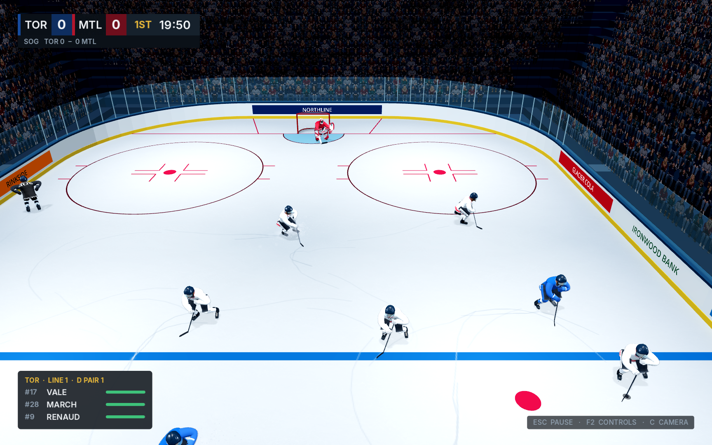
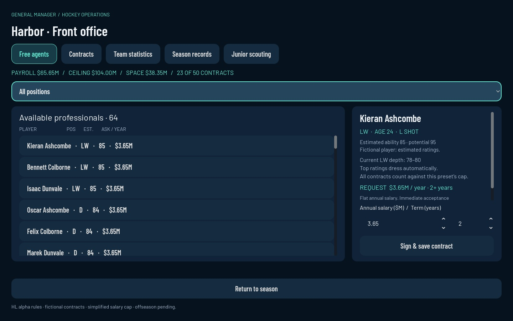

# Hawkey

[](https://github.com/BobbyBaccala/hawkey/actions/workflows/project-checks.yml)

A native **Godot hockey simulation** with original fictional leagues, playable
exhibitions and a growing general-manager mode. **Alpha development**: realistic
hockey and deep management are the targets; complete rules, Career, multi-season
GM and AAA visual quality are still in development.

[Play the development branch](#run-the-game) · [Roadmap](docs/ROADMAP.md) ·
[Contribute](CONTRIBUTING.md) · [Feature audit](docs/ALPHA_FEATURE_AUDIT.md)

| On the ice | In the front office |
|---|---|
|  |  |

The left image is an existing presentation-prototype capture; the right is an
actual Godot GM UI capture. Screenshots are development evidence, not a claim
that all platforms or graphics configurations have been validated.

## What you can play

| Mode | Working scope | Important next work |
|---|---|---|
| Play Now | League/team selection, exhibition, results/rematch, overtime and shootout | Complete rule exceptions, richer setup and physical-controller feel |
| Practice | Shared skating, puck, shot and pass mechanics | Structured drills and feedback |
| GM Season | 32 HL clubs, 62-game regular season, play/sim, standings and persistent saves | Playoffs, offseason, trades, draft and development |
| Front office | Free agents/contracts, cap checks, junior scouting, team statistics and season game records | Verified NHL-based contract rules, player/goalie stat ledger and histories |

The original saved world contains **33 leagues, 643 clubs and 14,745 players**:
32 HL teams, professional farm tiers, North American juniors, European leagues
and youth leagues. Youth currently supports browsing, not age-specific play.
GM adds a 64-player fictional professional free-agent market. Ratings are
uncalibrated estimates. See [world coverage](docs/HL_WORLD.md) and
[GM operations](docs/GM_OPERATIONS.md) for exact functionality and limitations.

## Run the game

1. Download/clone **`codex/game-modes`**, the current combined development branch.
   `main` does not yet contain this complete playable build.
2. Install **Godot 4.6.3 standard edition**. No paid plugin or .NET SDK is required.
3. Import this checkout's `project.godot` and press **F5**.

```sh
git clone --branch codex/game-modes https://github.com/BobbyBaccala/hawkey.git
cd hawkey
godot --path .
```

The title offers Play Now, GM Season, Practice and Preferences. Forward+ is the
preferred renderer; Godot can fall back to OpenGL. Compatibility can be requested
with `godot --path . --rendering-method gl_compatibility`. The current cloud Mesa
renderer has known 3D limitations; native UI captures do not establish desktop
GPU performance. Physical-controller and packaged-platform testing remain open.

## Current controls

| Input | Action |
|---|---|
| Left stick | Skate and place net-targeted shots |
| Right stick up / down then up | Wrist shot / slap-shot gesture |
| R2 / RT | Hold/release pass with possession; switch player without possession |
| R1 / RB | Saucer pass with possession; poke check without possession |
| Right stick without possession | Body check |
| L3 / left-stick click | Hustle |
| WASD / Shift / Ctrl | Skate / effort / stop |
| Left mouse / Alt + left mouse | Wrist / slap shot |
| Right mouse / Space | Pass / switch player |
| 1–4 / Q | Forward line / defence pair |
| C / mouse wheel | Camera / zoom |
| Escape / F2 | Pause / controller help |

Shots do not gain power by holding a button. See
[controls and tie-break scope](docs/CONTROLS_AND_TIEBREAKS.md) for the implemented
Skill Stick subset and remaining advanced controls. Hardware feel is unverified.

## Check a change

With Python 3.10+ and Godot 4.6.3 on your PATH:

```sh
python3 tools/check_project.py --suite smoke
python3 tools/check_project.py --suite all --workers 2
```

The same full-check command is configured for GitHub pull requests and development
pushes. It checks engine version/import, executes native suites and Python tests,
and writes per-check logs plus JSON/JUnit reports under `build/checks/`.
Optional mocap is reported as skipped when its local clips are absent. CI logs
are retained as workflow artifacts; a committed workflow is not a claim that a
remote run has already passed. See [contributing](CONTRIBUTING.md) for installation,
branch ownership, save safety and review expectations.

## Development direction

Next: an authoritative played/simulated player-stat ledger, player/goalie leaders
and history, then deeper roster management and the draft/offseason loop. In
parallel, continue skating/goalie/tactical/rule work and presentation polish.
[Roadmap milestones](docs/ROADMAP.md) link to the detailed production backlog.

Presentation is developed on `prototype/skating-puck-lab`; mode/simulation work
integrates on `codex/game-modes`. Preserve both streams and use focused feature
branches for concrete changes. No automatic PR merge, deployment or game release
is configured.

## Assets and notices

Characters, equipment, arena, generated content and fonts have documented source
and attribution notes in [ASSETS.md](docs/ASSETS.md) and the
[font notices](assets/fonts/README.md). Raw Mixamo clips are optional local files
and are not redistributed; see [motion capture](docs/MOTION_CAPTURE.md).
A project-wide redistribution license has not yet been selected. Adding an asset
or reference does not replace the need to preserve its own applicable notices.
