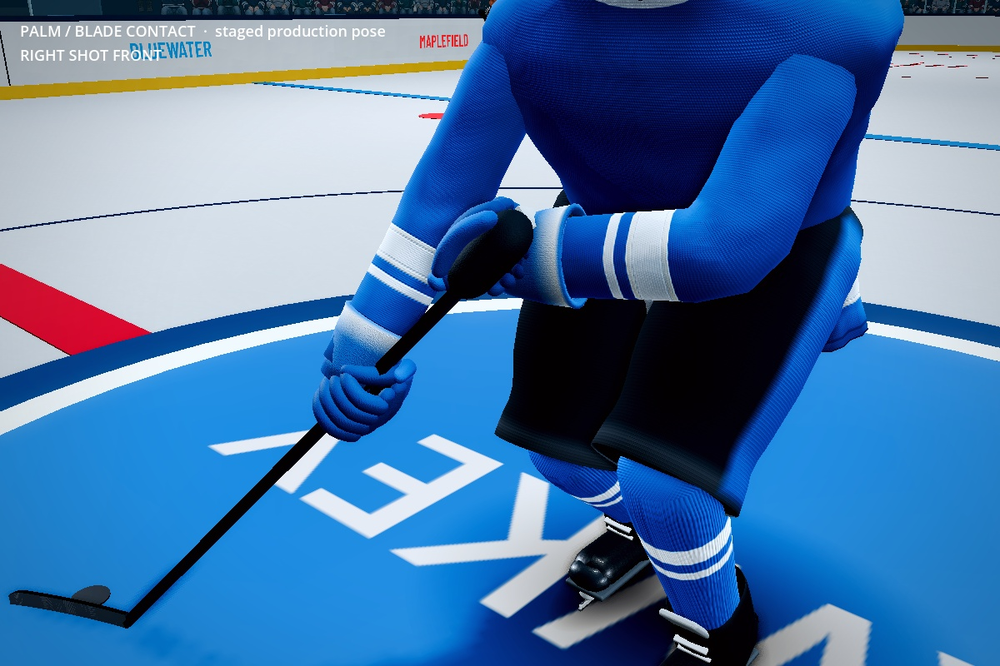
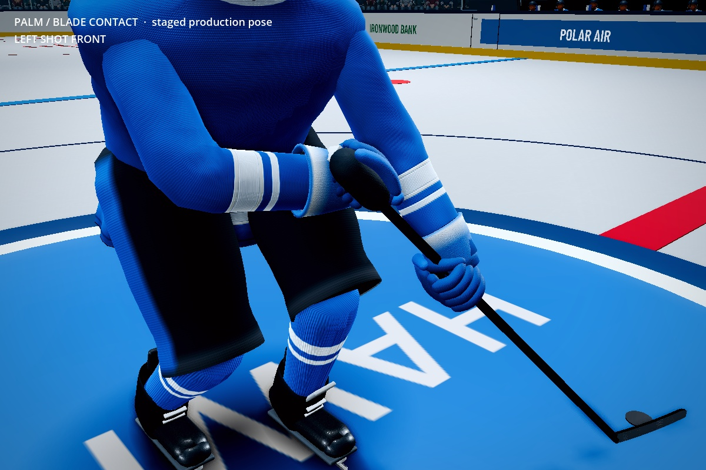
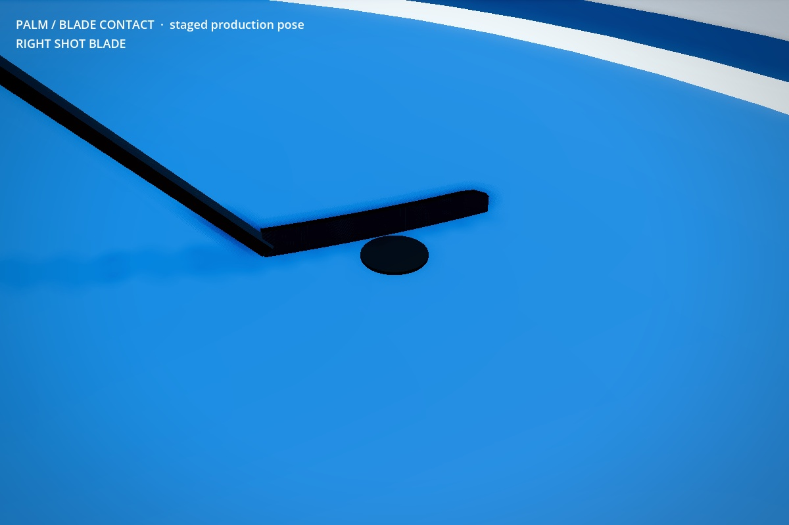
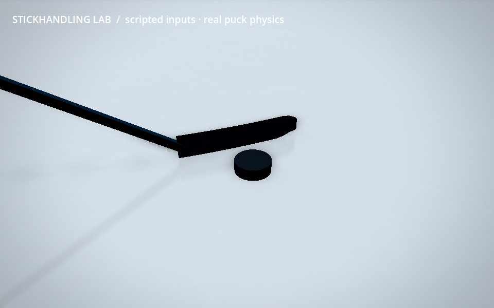

# Palm roles and puck/blade contact — 2026-10-22

Production and capture source: `a68d0ea5176f0f79f46a2d8bd4dc488764bcef21`.
Owner-requested correction following the rejected shaft-aligned grip. Uses the
supplied stance photographs as anatomical references, together with the owner's
explicit top-palm-down / lower-palm-up instruction. No reference image, identity
or brand is redistributed. This supersedes the deforming cuff approach in
SHAFT_ALIGNED_GRIP.md; those older results do not establish owner approval.

The fist's shaft channel remains parallel to the shaft. Its palm normal now
uses hand role: top down, lower up, mirrored for left-handed shots. Down/up is
projected perpendicular to the diagonal shaft; a palm normal cannot be parallel
to the shaft passing through a closed fist. Arm reach and shooting-side carry
remain intact. The cuffs are compact rigid gauntlets around the forearm, with
fixed 136 mm opening width (140 mm rolled rim) and 114 mm axial length. Animation changes transforms,
never their vertices. This also removes per-pose cuff mesh regeneration.

The old puck target was the blade mesh center. The shared get_blade_world()
API now returns the puck-center pocket outside the curved face, accounting for
the disk radius and an approximately 7 mm nominal face gap. Its ice height is
12.7 mm. blade_position remains the visual center, so consumers must distinguish
these two concepts. Goalkeeper pocket APIs and gear are preserved.

Skaters now have a posed curved convex blade collider generated from the same
17 cross-sections as the rendered 280 × 50 × 9 mm blade. Dedicated layer 7
(value 64) avoids the ice support (16) and goalie-only net guard (32). Eligible
actor toggles enable/disable blade contacts with the rest of the gear. Blades
are posed static contact volumes; carry assistance and release supply stick
velocity. This is not a full rigid-body stick/arm simulation.

Native CCD alone missed fast contacts against a 9 mm blade. The free puck now
sweeps its actual convex disk against the blade layer, tracks previous/current blade poses, and resolves
existing blade/disk overlaps plus curved-face endpoint contact. Contact
separation is converted to velocity over the physics tick, avoiding the
transform/CCD conflict exposed by the moving-deke fixture. The blade volume
is query-only, preventing duplicate native solver impulses. No puck attachment
or carrier-position snap is used. Free flight, goalie contacts,
release positions and the analytic ice plane retain their existing paths.
An 18 mm query/separation skin accommodates the discrete posed collision
volume. The executed deke test independently requires less than 5 mm actual
penetration and zero central-face crossings; a skin is not permission to
report invisible overlaps as successful contacts. No claim of mathematically
zero sub-tick penetration across all gameplay situations is made.

Verification and genuine Godot screenshots/video are recorded in
[verification/palm-blade-20261022.json](verification/palm-blade-20261022.json).
Static close-ups are explicitly staged poses. The motion clip uses scripted
skill inputs with production skating, pose, possession and rigid-body puck;
one initial placement, no subsequent attachment/reposition. It changes camera
from hands to the puck-facing blade midway. It is not natural AI gameplay.

Remaining: specialist glove mesh/material detail, human anatomical/feel review,
broader pressured puck battles and blade motion at extreme angular speeds.
Tests do not establish AAA presentation or owner acceptance.

Observed at the pinned source: 4,500 shaft/palm/cuff geometry checks; 30
unassisted blade checks covering both shot hands, both impact faces, 5/14 m/s
free pucks and a blade pushing a resting disk. The moving-deke/protection fixture has
1,351 checks, 960/960 ticks held, zero detected hull overlaps, zero central-face
crossings and maximum puck-to-pocket distance 0.1591 m. It actually exercises
90 moving-blade and 230 disk-sweep contacts. Both handed runs include protection entry/exit and retain
1,920/1,920 ticks, maximum gap 0.1591 m, and actual AI pickup remains 130/129
ticks. These are deterministic fixtures, not full-match balance/feel claims.

Right shot, front view (staged production pose):

Left shot, front view (staged production pose):

Blade-face clearance (staged pose, not physics evidence):

[Right reverse view](screenshots/palm-blade-right-reverse-20261022.jpg) ·
[Left reverse view](screenshots/palm-blade-left-reverse-20261022.jpg) ·
[Left blade](screenshots/palm-blade-left-blade-20261022.jpg) ·
[8-second scripted-input physics inspection](videos/palm-blade-physics-8s-20261022.mp4).

All 29 affected headless suites passed on the pinned source with no script or
engine errors, including receiving, flight, goal-mouth shots/net guard,
AI/tactics, goalie/bench geometry, Play Now and OT/shootout. The actual rendered
clip holds possession in all 16 half-second samples (largest sampled pocket
gap 0.1830 m). Its H.264 export is 960 × 600, 240 frames, exactly 8 seconds,
silent and fully decoded without errors. Offline software recording took
90 seconds for 273 untrimmed frames; this is not a hardware FPS benchmark.

Actual moving protection frame (not a staged puck position):

